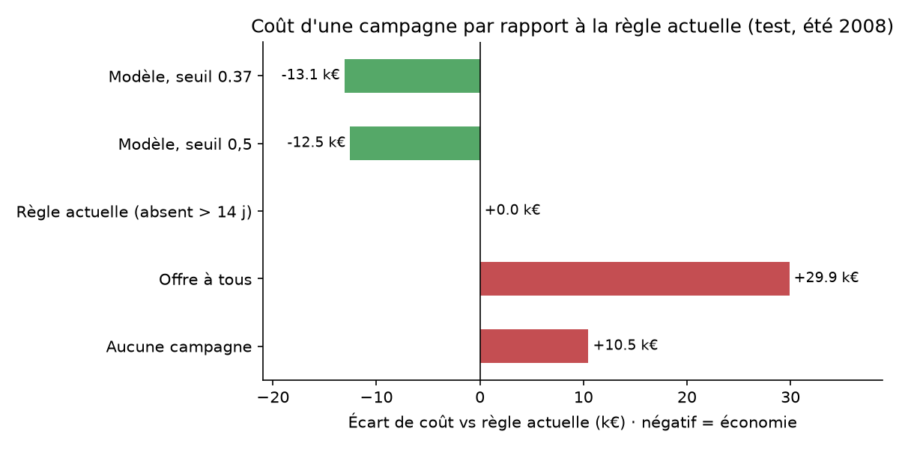

# Prédiction du churn des joueurs d'un MMO par abonnement

Projet final de Science des Données (module S7MOI1, ECAM-EPMI, 2AE).

## Le problème

Un éditeur de jeu en ligne par abonnement perd des revenus chaque fois qu'un joueur arrête de jouer. L'équipe rétention veut savoir, à une date donnée, **quels joueurs actifs risquent de ne plus revenir dans les 3 mois**, afin de leur envoyer une offre (mois gratuit, bonus) avant qu'ils partent.

- **Cible** : `churn_3m` = 1 si un joueur actif dans les 30 jours avant la coupure n'apparaît plus du tout dans les 3 mois suivants.
- **Type** : classification binaire supervisée.
- **Validation** : découpage chronologique. Entraînement sur la coupure du 1er avril 2008, test sur celle du 1er juillet 2008.

## Résultats clés

- **Données** : 10,8 millions de relevés de connexion, 37 354 personnages, année 2008. 31,4 % des joueurs actifs en mars ne reviennent pas d'avril à juin.
- **Modèle retenu** : Random Forest dans un pipeline scikit-learn, PR-AUC de 0,776 ± 0,014 en validation croisée (baseline : 0,314 ; régression logistique : 0,736).
- **Sur l'été 2008, période jamais vue** (seuil 0,37 choisi par le coût) : le modèle repère **82 % des joueurs qui partent**, et **56 % des offres** vont à des joueurs réellement sur le départ. La règle actuelle (relance après 14 jours d'absence) n'en repère que 48 %.
- **Valeur** (hypothèses explicites, notebook 03) : environ **13 100 € économisés par campagne trimestrielle** et par serveur par rapport à la règle actuelle, soit **52 000 €/an**, pour un projet à 35 000 € : **ROI de 50 % la 1re année**, retour en 8 mois. Le résultat dépend surtout du taux de réussite de l'offre, à valider par un pilote.



## Lancer le projet

```bash
python -m venv .venv
# Windows : .venv\Scripts\activate    macOS/Linux : source .venv/bin/activate
pip install -r requirements.txt
```

1. Télécharger les données en suivant [data/README.md](data/README.md).
2. Lancer `jupyter notebook`, ouvrir les notebooks **dans l'ordre** (01, 02, puis 03) et faire *Restart & Run All*. Le 02 prend environ 2 minutes ; le 03 lit les probabilités produites par le 02.

## Structure

```
projet-churn-wow/
├── README.md
├── requirements.txt
├── data/                     # données brutes (non versionnées, voir data/README.md)
├── notebooks/
│   ├── 01_cadrage_eda.ipynb  # cadrage, qualité, cible, relations, audit de fuite
│   ├── 02_modelisation.ipynb # baselines, modèles, validation croisée, test final
│   └── 03_decision_roi.ipynb # coûts, seuil, ROI, sensibilité, risques
├── src/
│   ├── features.py           # chargement et construction des variables par joueur
│   └── modeling.py           # préparation (pipeline), règle métier, fonctions de coût
└── reports/
    ├── figures/              # graphiques générés par les notebooks
    └── predictions/          # probabilités produites par le notebook 02, lues par le 03
```

## Données

World of Warcraft Avatar History, Y.-T. Lee, K.-T. Chen, Y.-M. Cheng, C.-L. Lei, ACM MMSys 2011, repris sur [Kaggle](https://www.kaggle.com/mylesoneill/warcraft-avatar-history). Licence CC0 (domaine public), consulté le 21/10/2026.

## Usage de l'IA générative

L'IA Claude (Anthropic) a été utilisée pour aider sur le code (`src/`) et les notebooks 01 à 03, ainsi que sur la mise en forme du rapport et de la présentation. Le code a été relu, exécuté et compris par l'auteur.